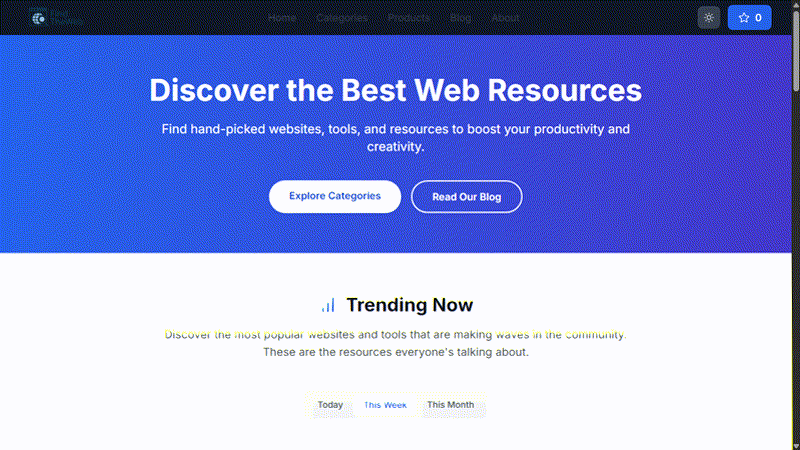

# FindTheWeb

<p align="center">
  
</p>

<h3 align="center">Discover the best websites, tools, and hidden gems on the internet.</h3>

<p align="center">
  <a href="https://findtheweb.zus3cu.tech">Live website</a> ·
  <a href="https://github.com/TheZubairUsman/findtheweb/issues">Report an issue</a> ·
  <a href="https://github.com/TheZubairUsman/findtheweb">Source code</a>
</p>

<p align="center">
  
  
  
  
</p>



> A quick preview of the real FindTheWeb homepage experience.

## What is FindTheWeb?

FindTheWeb is a curated website-discovery platform for people who want useful tools without wasting time searching through noisy results. It organizes productivity tools, AI services, creative resources, developer utilities, research links, and other internet discoveries into a focused directory.

The project combines a polished static React build with an Express/Sequelize API and an admin-only content workflow.

## Highlights

- Curated discovery across productivity, AI, design, development, research, and business categories
- Search, category browsing, regional filters, tier-based discovery, and bookmarks
- Responsive interface with light/dark mode support
- Editorial journal layout inspired by modern reading platforms, with featured stories and reading-time cues
- API-resilient Products and Blog surfaces that remain useful when optional backend content is unavailable
- Admin dashboard for managing websites, products, categories, and posts
- Express API with JWT-based admin authentication and rate limiting
- SEO-ready metadata, structured data, sitemap, robots rules, and social sharing tags
- GitHub Actions workflow for backend regression tests
- Deployment artifact prepared for Apache/Nginx/Hostinger static hosting

## Technology

| Layer | Technology |
| --- | --- |
| Frontend artifact | React, Vite, JavaScript, CSS |
| Backend | Node.js, Express, Sequelize |
| Data | Sequelize blog store with JSON exports retained for legacy directory data |
| Authentication | Server-side admin credentials, bcrypt, JWT |
| Quality | Jest, Supertest, model and API tests |
| Hosting shape | Static `dist/` frontend + persistent Node API |

## Repository layout

```text
.
├── dist/                    # Verified production frontend artifact
├── backend/                 # Express API, models, routes, tests
├── backend/data/            # Curated public content exports
├── docs/                    # Repository media and supporting assets
├── Doc/                     # Product, SEO, legal, and monetization plans
├── .env.example             # Safe configuration template
└── .github/workflows/       # Automated backend test workflow
```

> The original frontend source tree is not included in this snapshot. `dist/` is the verified build artifact currently available for deployment.

## Run locally

### Backend

```powershell
Set-Location backend
Copy-Item .env.example .env
npm ci
npm test -- --runInBand
npm start
```

The API exposes `/health` and `/api/v1/*`. Configure `ADMIN_EMAIL`, `ADMIN_PASSWORD`, `JWT_SECRET`, and database/session values only in the private server environment.

When the API is behind the single production Nginx proxy, keep `TRUST_PROXY=1` so rate limiting uses the real client address safely. Set it to `false` only when the service is exposed directly without a trusted reverse proxy.

Phase 2 also exposes a privacy-safe event endpoint at `POST /api/v1/analytics/events`. It accepts only allowlisted discovery events (`page_view`, `article_open`, `product_click`, `save_intent`, and `newsletter_interest`) and stores no raw IP, email, cookie, or user-agent data. Authenticated admin stats include bounded event counts for product and editorial decisions.

The discovery MVP is available at `GET /api/v1/discover` with `newest`, `trending`, `popular`, search, tier, and category filters. Community submissions use `POST /api/v1/discover/submissions`; they are rate-limited and enter a `pending` moderation queue instead of publishing automatically.

Authenticated moderators can review that queue through `GET /api/v1/admin/submissions` and `PATCH /api/v1/admin/submissions/:id` with `{ "decision": "approve" }` or `{ "decision": "reject" }`.

The discovery-friendly SEO feeds are generated from the canonical database through `GET /api/v1/seo/sitemap.xml` and `GET /api/v1/seo/rss.xml`. They include the public journal and discovery entry points plus published articles only; set `PUBLIC_SITE_URL` on the server when deploying to another hostname.

### Frontend preview

Serve the contents of `dist/` with any static HTTP server. For a production-like setup, reverse-proxy `/api/*` to the backend service.

## Production deployment

For `https://findtheweb.zus3cu.tech`:

1. Serve the contents of `dist/` from the subdomain document root.
2. Run `backend/src/index.js` as a persistent Node service on a Node-capable host.
3. Reverse-proxy `/api/*` to the backend port.
4. Set `CLIENT_URL`, `FRONTEND_URL`, and `CORS_ORIGINS` to the HTTPS domain.
5. Configure TLS, backups, process restart, and an uptime check for `/health`.

## Security

- Never commit `.env`, admin passwords, JWT/session secrets, SMTP credentials, database credentials, or source maps.
- Frontend `VITE_*` values are public; secrets belong in the backend environment only.
- The backend requires explicit `ADMIN_EMAIL` and `ADMIN_PASSWORD` for first-admin bootstrap.
- Use unique production credentials and rotate any credential that was previously exposed in local/debug material.

## Verification checklist

- [x] Local frontend smoke-tested in a browser
- [x] Authentication regression suite passes: 6/6 tests
- [x] Production health endpoint returns JSON over HTTPS
- [x] Public blog API returns published posts with pagination
- [x] Admin API rejects unauthenticated requests with JSON `401`
- [x] CORS preflight allows the production frontend origin
- [x] Products route redirects to the journal while the product surface is paused
- [x] No tracked `.env`, database, debug files, or source maps
- [x] Production-domain SEO metadata, robots, and sitemap are present
- [x] Privacy-safe analytics ingestion is rate-limited and covered by tests
- [x] Admin role detection supports authenticated draft visibility
- [x] Canonical database-backed sitemap and RSS feeds are covered by tests

> Phase 2 consolidation is complete for blog content: public blog reads and admin publishing use the canonical Sequelize `BlogPost` store. Legacy JSON exports remain only for non-blog directory compatibility and are not used as a blog fallback.

## Project identity

Built and maintained by **Zubair Usman — ZUS3CU**.

- GitHub: [@TheZubairUsman](https://github.com/TheZubairUsman)
- Live project: [findtheweb.zus3cu.tech](https://findtheweb.zus3cu.tech)

## License

This repository currently uses a project-defined license policy. Contact the maintainer before reusing branding, curated data, or commercial assets.

